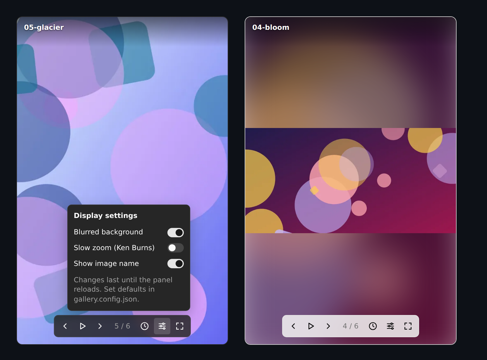

# Orca Gallery Panel

[](https://github.com/jerrazuw/orca-gallery-panel/actions/workflows/ci.yml)
[](LICENSE)

**Background images for [Orca](https://orca.dev), the agent IDE.** Orca has no setting for a
wallpaper or background image, so this plugin adds a side panel that shows a rotating gallery of
your own pictures while your agents work: wallpapers, photos, art, mood boards.

You point it at a folder, it packs the images into an Orca panel plugin, and the panel shuffles
through them with a slideshow, a blurred background, an optional Ken Burns zoom and controls you
can change without leaving Orca.



## Features

- **Slideshow**: shuffles your images and changes them on an interval you choose. Every image
  shows once before any repeats, and the same one never appears twice in a row.
- **Controls** on hover: previous, pause/resume, next, a position counter, interval, display
  settings and fit/fill.
- **Settings in the panel**: click the clock to type the seconds between images (`0` stops the
  automatic change), or the sliders to turn on a blurred background, a slow Ken Burns zoom or
  the image's name. Changes last until Orca reloads the panel, because Orca gives panels no
  storage; the defaults come from your build settings.
- **Blurred background**: an image that doesn't fill the panel sits on a blurred copy of itself
  instead of empty bars.
- **Several galleries**, each in its own panel, from one config file.
- **Watch mode**: `--watch` rebuilds whenever you add or remove images, and Orca reloads the
  panel, so a new photo shows up without touching the terminal.
- **Keyboard**: `←` / `→` to navigate, `Space` to pause, `F` to switch between fit and fill.
- **Matches Orca's theme**, light or dark, using the design tokens Orca gives every panel.
- **Any common format**: PNG, JPEG, GIF, WebP, AVIF and TIFF. Animated GIF and WebP stay
  animated, and EXIF rotation is applied.
- **English and Spanish**, picked from the system language.
- **Accessible**: labeled buttons, visible focus, and no fade if you have reduced motion turned on.
- **Private**: the plugin asks Orca for no permissions and makes no network requests.

## Quick start

Requires [Node.js](https://nodejs.org) 22.18 or later and Orca 1.4.160 or later.

```bash
git clone https://github.com/jerrazuw/orca-gallery-panel.git
cd orca-gallery-panel
npm install
npm run build -- ~/Pictures/wallpapers --title "Wallpapers"
```

The plugin is written to `dist/`. In Orca, go to **Settings → Plugins → Development**, click
**Add path** and enter the full path to `dist/`. Then open the panel from the right sidebar.

To try it without your own pictures, build the bundled samples: `npm run build -- examples/images`.

### Saving your settings

Instead of repeating options on every build, copy the example config and edit it:

```bash
cp gallery.config.example.json gallery.config.json
```

```json
{
  "$schema": "./gallery.config.schema.json",
  "folder": "~/Pictures/wallpapers",
  "title": "Wallpapers",
  "interval": 60
}
```

From then on, `npm run build` is enough. `gallery.config.json` is ignored by git, so your paths
stay on your machine. The `$schema` line gives you autocomplete and validation in editors that
support JSON Schema. Options passed on the command line still override the file for that build,
and `--config <file>` reads a different one.

### Updating your images

Add or remove files in your folder and run `npm run build` again. A plugin loaded from
**Development** reloads on its own.

Or leave `npm run build -- --watch` running: it rebuilds whenever an image in your folders or
the config file changes, and a burst of changes (copying 20 photos at once) triggers a single
rebuild.

If you installed it with **Install plugin → Local folder** instead, Orca keeps a copy, so you
need to install it again after each build.

## Options

| Option                  | Config key  | Default   | Description                                       |
| ----------------------- | ----------- | --------- | ------------------------------------------------- |
| `[folder]`              | `folder`    | `images`  | Folder with your images.                          |
| `-o, --out <dir>`       | `out`       | `dist`    | Output folder for the plugin.                     |
| `-t, --title <text>`    | `title`     | `Gallery` | Panel title shown in Orca.                        |
| `-i, --interval <sec>`  | `interval`  | `180`     | Seconds between images. `0` disables rotation.    |
| `-s, --max-size <px>`   | `maxSize`   | `800`     | Longest side of each image, in pixels.            |
| `-q, --quality <1-100>` | `quality`   | `80`      | WebP quality.                                     |
| `--fit <mode>`          | `fit`       | `contain` | Initial mode: `contain` (whole image) or `cover`. |
| `--effect <name>`       | `effect`    | `none`    | `none`, or `kenburns` for a slow zoom.            |
| `--no-blur`             | `blur`      | `true`    | Blurred background behind images.                 |
| `--caption`             | `caption`   | `false`   | Show the image's file name.                       |
| `-r, --recursive`       | `recursive` | `false`   | Include images in subfolders.                     |
|                         | `galleries` |           | Several galleries; see above.                     |
| `-w, --watch`           |             |           | Rebuild when images or the config file change.    |
| `-c, --config <file>`   |             |           | Config file to read instead of the default.       |

Precedence: command line, then the gallery's own settings, then the top level of
`gallery.config.json`, then the defaults. Paths in the config file are relative to the file, and
`~` means your home folder. The `fit`, `interval`, `blur`, `effect` and `caption` settings are
only where the panel starts: you can change them from the panel itself.

### Several galleries

List them under `galleries`. Each one becomes its own panel in Orca. Settings at the top level
apply to every gallery unless it sets its own; the top-level `title` names the plugin, and a
gallery without a `title` is named after its folder.

```json
{
  "$schema": "./gallery.config.schema.json",
  "title": "My galleries",
  "interval": 120,
  "galleries": [
    { "folder": "~/Pictures/wallpapers", "title": "Wallpapers", "effect": "kenburns" },
    { "folder": "~/Pictures/art", "interval": 30, "caption": true }
  ]
}
```

Each panel has to stay under Orca's 10 MiB limit for a panel, and all of them together under
its 50 MiB limit for a plugin.

## How it works

Orca renders a plugin panel as a sandboxed `srcdoc` iframe whose Content Security Policy only
allows inline scripts and styles and `data:` images. A panel cannot read files from disk, and
Orca's plugin API gives it no file or folder access either.

So the images are packed into the panel when you build it:

1. `src/images.ts` finds the supported images in your folder, in natural order.
2. `src/encode.ts` uses [sharp](https://sharp.pixelplumbing.com) to apply EXIF rotation, shrink
   each image to `--max-size` and re-encode it as WebP. That keeps transparency and animation,
   and is far smaller than base64-encoded PNGs or GIFs.
3. `src/html.ts` bundles the panel script (`src/panel/`, TypeScript) with
   [esbuild](https://esbuild.github.io) and inlines it, the CSS and the images into one
   `panel.html`.
4. `src/build.ts` checks the result against Orca's 10 MiB limit for a panel. If it's over, it
   names the largest images and suggests what to change.
5. `src/manifest.ts` writes `orca-plugin.json`, taking the version from `package.json`, with
   one panel per gallery.

At the default settings a typical photo ends up around 40 KB, so the limit fits a couple of
hundred images. Animated GIFs are much heavier.

## Development

```bash
npm run check        # typecheck, lint, format check and unit tests
npm run test:e2e     # the panel in headless Chromium (first run: npx playwright install chromium)
npm run preview      # writes dist/preview.html: the built panel inside an Orca-like frame
```

| Path                           | What it is                                                                    |
| ------------------------------ | ----------------------------------------------------------------------------- |
| `src/cli.ts`, `src/options.ts` | Command-line entry point and argument parsing.                                |
| `src/build.ts`                 | Builds the plugin: find, encode, render, check size, write.                   |
| `src/panel/`                   | The code that runs inside Orca: slideshow, controls, translations and styles. |
| `src/watch.ts`                 | Watch mode: reruns the build when the watched folders change.                 |
| `src/preview.ts`               | Reproduces Orca's panel shell so the panel can be checked in a browser.       |
| `test/`                        | Unit tests (`node:test`) and browser tests (`test/e2e/`, Playwright).         |
| `examples/images/`             | Sample images, made by `scripts/generate-examples.ts`.                        |

TypeScript runs directly on Node through
[type stripping](https://nodejs.org/api/typescript.html#type-stripping), so there is no compile
step while you work on it. Node won't strip types inside `node_modules`, so the npm package is
compiled to `lib/` by `npm run build:lib`, which `npm pack` runs on its own. CI runs on Linux,
macOS and Windows with Node 22.18, 22 and 24, and installs the packed package in an empty
project to check that the command works.

## Why it isn't in the Orca marketplace

Plugins in the [Orca marketplace](https://github.com/stablyai/orca-plugins) are installed from a
git repository as they are, but this panel only works once it has been built with your images. A marketplace entry could only ship the sample gallery.

## Contributing

Issues and pull requests are welcome; see [CONTRIBUTING.md](CONTRIBUTING.md).

## License

[MIT](LICENSE). The sample images in `examples/images/` are generated by code in this repository
and are covered by the same license.
